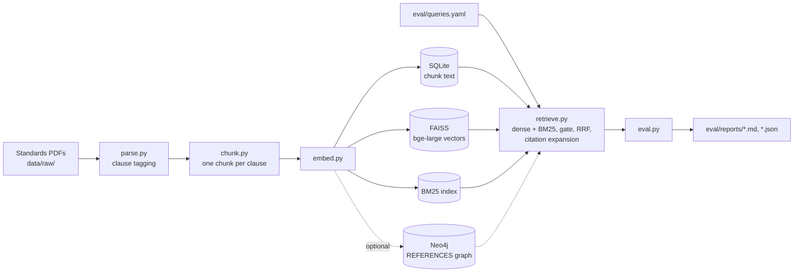

# ASME-Style RAG Evaluation Harness

A retrieval pipeline and evaluation harness for clause-structured engineering standards that measures whether hybrid search finds the right clause, follows its cross-references, and abstains on questions the corpus cannot answer.

## Overview

Engineering standards are cited clause by clause, and clauses depend on each other, so fixed-size chunking returns fragments of rules and plain vector search confidently answers questions the documents never cover. This project parses standards PDFs into one chunk per numbered clause, indexes them for both BM25 and dense search, fuses the rankings with reciprocal rank fusion (RRF), follows clause cross-references, and abstains when lexical and semantic evidence are weak. A 20-query evaluation set scores every change with Recall@k, MRR, abstention precision and recall, and a citation hit rate, and writes a timestamped report. The development corpus was NASA-STD-5019 (fracture control for spaceflight hardware) and API 510 (pressure vessel inspection), standing in for ASME BPVC, which is licensed. No standard PDFs are included in the repository.

## Highlights

- **Clause-aware chunking:** PyMuPDF text is tagged with the current clause number by regex; each clause becomes one chunk and is split only past about 2,000 tokens, keeping the clause ID with a `#partN` suffix (`src/parse.py`, `src/chunk.py`).
- **Hybrid retrieval:** BM25Okapi plus `BAAI/bge-large-en-v1.5` embeddings in a FAISS `IndexFlatIP` (cosine on normalized vectors), top 50 candidates per leg, fused with RRF at k = 60 (`src/embed.py`, `src/retrieve.py`).
- **Dual abstention gate:** the query is refused if the top cosine similarity is below 0.40 or the best BM25 score is below 10.0. The BM25 check exists because the embedding model places short off-topic questions close to technical text.
- **Citation expansion:** cross-references (clause numbers, Section, Table, Figure, Appendix) are extracted by regex and followed one hop, through a Neo4j graph when `NEO4J_URI` is set and from an in-memory reference list otherwise (`src/graph.py`).
- **Prefix-aware scoring:** an expected clause `4.1` is satisfied by `4.1.2` or `4.1#part0` but not by `4.10` (`src/eval.py`).

## Architecture



## Results

From the latest saved run, `eval/reports/eval_20260503_220659.md` (20 queries: 12 in-corpus, of which 4 test cross-references, plus 5 out-of-corpus and 3 ambiguous questions that should be refused):

| Metric | Value |
|---|---|
| In-corpus Recall@1 | 0.917 |
| In-corpus Recall@3 / @5 / @10 | 1.000 |
| In-corpus MRR | 0.944 |
| Abstention precision | 1.000 |
| Abstention recall | 0.750 (6 of 8) |
| Citation hit rate | 1.000 (4 of 4) |

The only ranking miss is q10, where the expected clause 8.1 came third. The two questions that should have been refused but were answered are q14 ("boiling point of water") and q17 (allowable stress under AISC 360, a steel code that shares vocabulary with the corpus). The three earlier runs from the same session, `eval_20260503_215647` to `eval_20260503_220414`, give identical numbers. The first run, `eval_20260503_215048` (Recall@5 0.333, no abstentions), was produced with an earlier version of the query set and gate. The output saved in `notebooks/threshold_calibration.ipynb` comes from that same earlier state and has not been re-run.

## Tech stack

Python 3.11, PyMuPDF, sentence-transformers (`bge-large-en-v1.5`), FAISS, rank-bm25, SQLite, Neo4j (optional), Pydantic, PyYAML.

## Quickstart

The standards PDFs are not included. NASA-STD-5019 is freely available from the NASA Technical Standards System; API 510 is a copyrighted standard sold by the American Petroleum Institute, so you need your own licensed copy. The queries in `eval/queries.yaml` are written against those two documents; for any other corpus, rewrite them against its clause numbers.

```bash
pip install -e .                 # dependencies from pyproject.toml (add ".[notebook]" for Jupyter)
cp .env.example .env             # optional: Neo4j credentials for the citation graph
mkdir -p data/raw                # add nasa_std_5019.pdf and api_510.pdf here

python -m src.parse              # data/raw/*.pdf -> data/parsed/<name>.json
python -m src.chunk              # -> data/parsed/chunks.json
python -m src.embed              # -> data/index.db, data/faiss.index, data/bm25.pkl (+ Neo4j if configured)
python -m src.eval --debug       # runs the 20 queries, writes eval/reports/eval_<timestamp>.md and .json
```

`python -m src.eval 0.45` changes the cosine threshold; the BM25 threshold is a parameter of `retrieve()`. `python -m src.graph stats` prints the node and edge counts of the citation graph. The first `src.embed` run downloads the embedding model (about 1.3 GB).

## Project structure

```text
src/
  parse.py      PDF -> lines tagged with page and clause number
  chunk.py      clause-level chunks and cross-reference extraction
  embed.py      SQLite store, FAISS and BM25 indexes
  graph.py      Neo4j citation graph (build, stats, one-hop lookup)
  retrieve.py   hybrid retrieval, abstention gate, citation expansion
  eval.py       metrics and Markdown/JSON reports
  schema.py     Pydantic models for chunks, queries and reports
  tables.py     table extraction via Azure Document Intelligence or pdfplumber (not yet wired in)
eval/
  queries.yaml  20 labeled queries in 4 categories
  reports/      saved evaluation runs
notebooks/
  threshold_calibration.ipynb   sweep of the cosine threshold
```

## Limitations and next steps

- Twenty hand-written queries over two documents make this a regression check, not a benchmark. Hard-negative generation and more queries per clause are the next additions.
- Scoring compares clause numbers only: `expected_documents` is recorded but not checked, so a clause with the same number in the other standard counts as a hit. The citation metric also counts a referenced clause that was retrieved directly rather than through the graph.
- The clause regex accepts any line that starts with a number, so values and page numbers (for example `0.50` or `36`) can become clause IDs, as seen in the saved reports.
- The BM25 threshold is a raw score tied to this corpus and must be recalibrated for new documents. Table extraction and a cross-encoder reranker are scaffolded but not part of the pipeline.

## License

No license specified yet.
